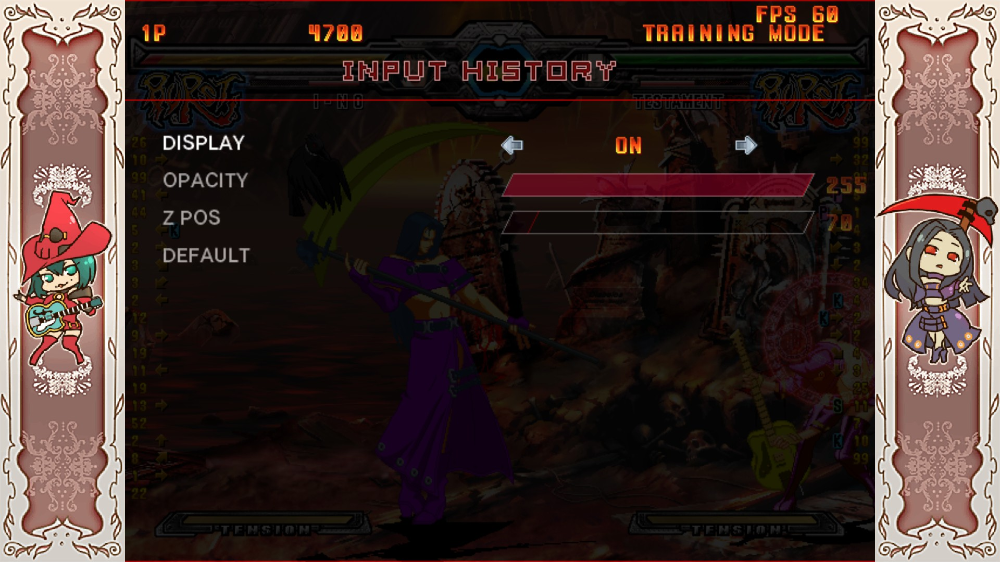

# ACPR Input History

Input history mod for Guilty Gear XX Accent Core Plus R (Steam) via [GearLoader](https://github.com/YouKnow232/GearLoader) by [YouKnow232](https://github.com/YouKnow232/).

It uses the Replay Mode input history to render the inputs on Training Mode. It was designed to be used in training mode - specifically in both Training and Online Waiting Modes - so it doesn't work in other modes.

<div align="center">
  
  <br/>
</div>


## Installation

* Download and install [GearLoader](https://github.com/YouKnow232/GearLoader) v1.1.1 or newer.
* Download the archive from [releases](https://github.com/Alquimas/ACPR_InputHistory/releases)
* Unzip it and place the mod folder into the "mods" folder

```text
Guilty Gear XX Accent Core Plus R/
└── mods/
    └── ACPR_InputHistory/
```

## Settings
<div align="center">
  
  <br/>
</div>

This mod features a settings menu that can be found at "Pause Menu -> Help & Options -> Mod Settings".

## Build Instructions
Build instructions are similar to [GearLoader's](https://github.com/YouKnow232/GearLoader).

### Prerequisites
* CMake v3.21 or later
* gcc v15.2.0 or later
    * i686-w64-mingw32-g++

For Windows users:
* MSYS2 environment

### Instructions
Run `Compile.sh` from the project root directory (in a MINGW32 shell for Windows users). You can set the environment variable `GGXXACPR_MOD_DIR` and the `Compile.sh` script will copy the build output to that directory.
